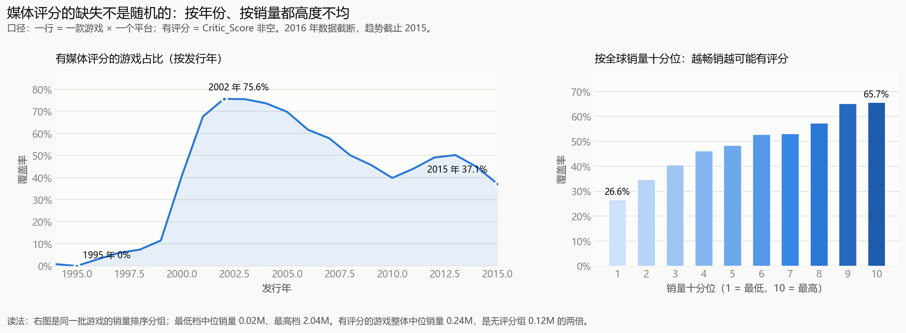
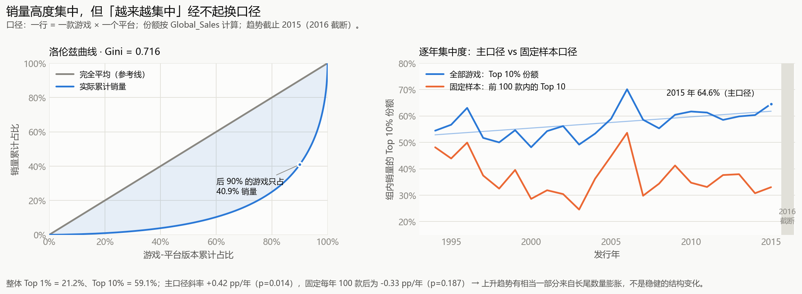

# 游戏销售数据分析（Video Game Sales）

用 1980–2016 年的电子游戏销量数据，做一轮完整的「导入 → 清洗 → 分析 → 可视化」，
并在每一步都主动追问：**这个结论站得住吗？**

**三条结论（先给答案）：**

1. **媒体评分的缺失不是随机的** —— 缺失与年份、销量强相关，所以任何「评分 vs 销量」的结论
   都只在被评分选中的那部分样本里成立，不能外推到全量游戏。
2. **销量高度集中** —— Gini = 0.716，Top 10% 的游戏拿走 59.1% 的销量。
3. **「赢家通吃在加剧」站不住** —— 全量口径下 Top10% 份额每年 +0.42pp（p=0.014），
   但把分母固定成「每年前 100 款」后，趋势变成 −0.33pp/年（p=0.187）。上升来自长尾数量膨胀，
   不是头部真的卖得更好了。

---

## 1. 项目背景与问题

**数据**：Kaggle「Video Game Sales with Ratings」，截止 **2016-12-22**，原始 16,719 行 × 16 列。

> 原始数据 `data/video_games_sales.csv`（1.6 MB）已随仓库提供，clone 下来即可直接运行。
> 原始来源是 Kaggle「Video Game Sales with Ratings」的
> `Video_Games_Sales_as_at_22_Dec_2016.csv`（数据文件为 CC0 许可）。
> `output/df_analysis_clean.csv` 是清洗后的结果，只想看分析结论的话不必重跑 notebook。

**分析单位是一行 = 一款游戏在一个平台上的版本**，不是「一款游戏」。
同名游戏跨平台（如 FIFA 同时出 PS4 / X360 版）会占多行，同名不同代
（如 NFS Most Wanted 2005 / 2012）也会占多行——这两件事看起来一样，实际必须区分，
是清洗阶段的核心难点。

**想回答的两个问题：**

| 问题 | 为什么值得问 |
|---|---|
| 媒体评分的缺失是随机的吗？ | 这是所有「评分影响销量」类分析的**前提**。如果缺失不随机，那么相关性可能只是样本选择效应 |
| 「赢家通吃」在加剧吗？ | 这是行业叙事的常见说法。它听起来合理、容易传播，正因如此更需要检验 |

选这两个问题，是因为它们都有一个共同点：**看起来能直接从数据里算出来，实际上很容易算错。**

---

## 2. 核心发现

### 2.1 发现一：媒体评分的缺失不是随机的

`Critic_Score` 有 **51.3% 的行是空的**。如果缺失随机，那删掉这些行只是损失样本量；
但实测发现缺失与两个维度都强相关：

| 维度 | 观察 |
|---|---|
| 按年份 | 1995 年覆盖率 **0%** → 2002 年 **75.6%** → 2015 年 **37.1%** |
| 按销量十分位 | 最低档 **26.6%** → 最高档 **65.7%**，单调上升 |
| 销量口径 | 有评分的游戏中位销量 **0.24M**，是无评分组 **0.12M** 的两倍 |



**含义**：有评分的样本系统性地偏向「较新、较畅销」的游戏。
所以后面任何「评分 vs 销量」的结论，都只在**被评分选中的样本内**成立。

> 这张图不产出业务结论，它只做一件事：**先给这份数据划定能力边界**。
> 这是整个分析的地基——后面的每一句话，都只能在这个范围内说。

### 2.2 发现二：销量高度集中

| 指标 | 数值 |
|---|---|
| 整体 Top 1% 份额 | **21.2%** |
| 整体 Top 10% 份额 | **59.1%** |
| Gini 系数 | **0.716** |
| 后 90% 的游戏占销量 | **40.9%** |



左图是洛伦兹曲线：蓝色曲线与灰色对角线之间的面积，就是 Gini 的几何含义。
标注选在 x = 90% 处——「后 90% 的游戏只占 40.9% 销量」比「Top 1% 占 21.2%」更好懂，
它直接告诉读者「绝大多数游戏几乎不赚钱」。

### 2.3 发现三：「赢家通吃在加剧」经不起换口径

右图同时画了**两个口径**，而它们得出的结论**相反**：

| 口径 | 做法 | 斜率 | p 值 | 结论 |
|---|---|---|---|---|
| 主口径（蓝） | 每年全部游戏里，销量前 10% 的份额 | **+0.42 pp/年** | 0.014 | 看似显著上升 |
| 反驳口径（橙） | 每年先固定取销量前 100 款，再在这 100 款内部算 Top10 | **−0.33 pp/年** | 0.187 | 不显著，甚至略降 |

**为什么这个反驳重要**：如果只画蓝线，结论会是「游戏行业越来越赢家通吃」——
一个听起来很合理、也很有传播力的故事。但它经不起一个简单的追问：**分母是不是变了？**

2000 年后进入数据集的游戏数量从每年约 300 款涨到约 1400 款，大量长尾小游戏稀释了销量，
Top 10% 的份额自然被推高。固定每年取前 100 款（样本量恒定），这个效应就被剔除，趋势随之消失。

**这一步的价值不在于「结论更悲观」，而在于主动给自己的结论找反证。**
这也是数据分析和「画图讲故事」的分界线。

---

## 3. 方法与验证

### 3.1 统一缺失口径

`read_csv` 只会把 `N/A`、空串这类标准形式识别为缺失，但这份数据里有大量**伪装成数据的缺失**：

```python
NA_TOKENS = {'', 'N/A', 'NA', 'n/a', 'TBD', 'tbd', 'Unknown', 'unknown', 'NULL', 'null', '-', '?'}
```

`missing_report()` 同时统计两类：真空值（`NaN/None/NaT`）和字面量缺失（字符串）。
另外 `User_Score` 里有 **2,425 个 `"tbd"`**（to be determined），必须用
`pd.to_numeric(..., errors='coerce')` 显式转成 `NaN`，否则它会作为一个合法字符串混进数值列。

**这一步决定了后面所有结论的适用范围**（见 2.1）。

### 3.2 清洗规则与行数账

```
原始 CSV                        16719 行
  │  3.0 统一缺失口径（"tbd" → NaN）
  │  3.1 dropna(['Name','Genre'])        删  2 行  → 16717
  │  3.2 合并被按地区拆分的同款            减  2 行  → 16715
  │  3.3 标记评分冲突（不删行，只打标）
  │  3.4 分类字段填显式标签（Unknown / Unrated）
  ▼
df_analysis                     16715 行，销量总额 8917.88（与清洗前完全一致）
```

| 步骤 | 做法 | 为什么 |
|---|---|---|
| **3.0 统一缺失口径** | `pd.to_numeric(..., errors='coerce')` 作用于 `Year_of_Release` / `User_Score` / `Critic_Score` | 把 `"tbd"` 这类字符串强制转成 NaN |
| **3.1 删关键字段缺失** | `dropna(subset=['Name','Genre'])` | 没名字、没类型的行无法参与任何分组分析。`how='any'` 默认是**并集**语义：Name 或 Genre 任一为空就删 |
| **3.2 合并拆分行** | 同 `(Name, Platform)` 下，若有效年份只有 1 个 → 判为同一款被按地区拆分，销量相加；年份有多个 → 判为两代作品，原样保留 | 例如 `Madden NFL 13 / PS3` 有两行，销量被拆成 2.56 + 0.01 |
| **3.3 标记评分冲突** | 同键不同年、但评分四元组完全相同 → 打 `score_conflict` 标记（不删行） | 数据源的评分是按 `(Name, Platform)` 关联的，年份不在键里，同名两代作品会撞到同一条评分记录 |
| **3.4 分类字段给显式标签** | `Publisher`/`Developer` → `Unknown`，`Rating` → `Unrated` | 这是「承认不知道」，不是瞎填 |

**3.2 实际只动了 4 组 8 行**，其中 2 组合并、2 组保留：

| 组 | 结果 | 说明 |
|---|---|---|
| Madden NFL 13 / PS3 | 合并 | 两行年份都是 2012，销量 2.56 + 0.01 = **2.57** |
| Sonic the Hedgehog / PS3 | 合并 | 一行年份缺失、一行 2006，销量 1.16 + 0.48 = **1.64** |
| Need for Speed: Most Wanted / PC | 保留 | 2005 与 2012，是两代作品 |
| Need for Speed: Most Wanted / X360 | 保留 | 2005 与 2012，是两代作品 |

**3.3 共标记 4 行**，正好就是上面「保留」的两组——它们的评分四元组完全相同，
说明数据源把两代的评分关联到了同一条记录。

> 一个容易搞混的点：3.1 删 2 行、3.2 减 2 行，但最终是 16719 − 4 = 16715。
> 这里减的不是「2 + 2 个列」，而是**行**：3.1 是并集删行，3.2 是把 2 组各 2 行合并成 1 行。

### 3.3 稳健性验证：主动找反证

除了 2.3 的「固定 100 款」口径，还做了两件事：

- **2016 截断处理**：2016 年只有 502 行（对比 2010–2014 年均约 834 行），
  所以所有时间趋势一律截止到 **2015**，2016 在图上用灰色竖带标注「截断」而不是直接不画。
- **含截断年份的对照**：把 2016 一起算，斜率 +0.28 pp/年、p=0.427，同样不显著——
  说明主口径的显著性本身就依赖口径选择。

---

## 4. 技术要点

### 4.1 性能：一次 groupby 从 20.5 秒降到 148 ms

清洗格最初跑一次要 20 秒。原因不在数据量（只有 1.6 MB），而在于两个**逐组回调的 Python 函数**：

```python
agg.update({c: first_valid for c in meta_cols})              # 9 列 × 16713 组
g[sig].transform(lambda s: s.nunique(dropna=False) == 1)     # 4 列 × 16713 组
```

这份数据 99.98% 的组只有 1 行，于是「按组回调」的次数约等于数据规模——共 **21.7 万次**。
每次调用都要构造 Series、走解释器、拆装箱，单次成本 65µs / 19µs，加起来就是 20 秒。

| 操作 | 原写法 | 新写法 | 倍数 |
|---|---|---|---|
| `first_valid` × 9 个 meta 列 | **12,214 ms** | `groupby.first()` 8.6 ms | ~1400× |
| 评分冲突 `transform(lambda ...)` × 4 列 | **8,099 ms** | `transform('nunique')` 7.3 ms | ~1100× |
| **整格合计** | **≈ 20.5 s** | **148 ms** | **≈ 140×** |

替换的关键是**语义等价**，不是图快：

- `groupby.first()` **本身就会跳过 NaN**，取「每组第一个非空值」——这正是 `first_valid` 的语义。
  （会取到 NaN 的是裸 `s.iloc[0]`，不是 `'first'`。）
- `transform('nunique')` 默认 `dropna=True`，不把 NaN 计入；原写法是 `dropna=False`。
  所以先用哨兵 `'__NA__'` 把 NaN 变成普通值，再走内置聚合，语义才一致。

改完逐列比对新旧两版，**16 列全部 MATCH**，行数、销量总额、冲突标记、填充数全部一致。

> 完整推导、单次调用成本、复现命令见
> [output/缺失值处理时提速方法.md](output/缺失值处理时提速方法.md)。

**教训**：能用内置字符串聚合（`'sum'` / `'first'` / `'nunique'`）就别写自定义函数；
组数接近行数时，UDF 的固定调用开销会彻底压过实际计算量。

### 4.2 代码设计：入库从 notebook 里拆出去

原始 CSV → MySQL 的入库，现在是一个独立脚本 [`scripts/load_to_mysql.py`](scripts/load_to_mysql.py)：

```bash
python scripts/load_to_mysql.py              # 建库 + 写入 + 校验
python scripts/load_to_mysql.py --dry-run    # 只检查配置和数据，不写库
python scripts/load_to_mysql.py --verify-only  # 只校验已入库的数据
```

notebook 里只剩「连上 MySQL，把表读成 `df`」这一件事。

**为什么拆：**

1. 入库是**一次性的准备工作**，不属于分析过程。放在 notebook 里，每次「Run All」
   都要重跑一遍全量写入，纯属浪费。
2. 入库失败时，命令行里能直接看到一条清晰的报错和修复提示，而不是埋在几十行输出中间。
3. notebook 只保留「读 → 清洗 → 分析 → 画图」这条主线，读起来更连贯。

脚本里几个不那么显然的处理：

| 处理 | 原因 |
|---|---|
| 用 `URL.create(...)` 拼连接串，不用 f-string | 密码里出现 `@ : / ? #` 时，f-string 拼的 URL 会被解析错；`URL.create` 自动做百分号编码 |
| 入库后回查行数和销量总额 | `to_sql` 失败可能静默截断；校验值（16719 / 8920.30）对上才算成功 |
| 建库前先连 server，不指定 database | 目标库可能还不存在 |
| `DB_HOST=localhost` 时打印提示 | Windows 会先试 IPv6 `::1` 再回落 IPv4，首次连接实测 2075ms vs 42ms |

### 4.3 可视化设计

两张图遵循同一套规则，目的是**让图承载信息，而不是承载装饰**。

#### 为什么先画「缺失」，而不是直接画结论

这份数据最容易犯的错误，是直接算「评分高的游戏卖得更好」。
但 `Critic_Score` 有一半是空的，而缺失本身不随机（见 2.1）。
如果缺失集中在低销量、早年发行的小游戏上，那「评分与销量正相关」可能只是**样本选择效应**。

所以图 1 不产出业务结论，它只做一件事：**先给这份数据划定能力边界**。

#### 图 1 · 评分覆盖偏差

**左图（按发行年，折线 + 面积填充）**

- 只画**一条线**：变量只有一个（覆盖率），单系列不需要图例框，标题已经点明对象。
- 用 `fill_between` 在曲线下方填 10% 透明度的同色块，让「曲线以下 = 有评分」在视觉上成立。
- **只标 3 个点**：1995 年 0%（起点）、2002 年 75.6%（峰值）、2015 年 37.1%（终点）。
  折线的形状本身已经传达了趋势，逐点标注只会制造噪声。
- `xlim(1994, 2015)`：右边界卡在 2015，把截断的 2016 排除在外，
  避免读者误读成「2016 年突然崩了」。

**右图（按销量十分位，柱状）**

- 为什么用**十分位**而不是散点：销量分布极端右偏（最大值 82.5M，中位数仅 0.17M），
  散点会被少数超级爆款主导；分成 10 档看「档内覆盖率」，能稳定呈现单调关系。
- 为什么用**单一蓝色系渐变**而不是彩色：十分位是**有序的连续量**，
  颜色深浅本身就能编码「从低到高」；用彩虹色反而会暗示「这是 10 个互不相干的类别」。
- 只标首尾两档（26.6% / 65.7%），中间八档靠柱高对比，同样避免数字堆砌。

**两张图共同的阅读辅助**

- 图下有一行**口径说明**：分析单位是「游戏 × 平台」而非「一款游戏」；
  右图最低档中位销量 0.02M、最高档 2.04M。这些数字在图上放不下，但正是「缺失不随机」的直接证据。
- 图下方还打印了**表 1、表 2**，把图上看不到的精确数值列出来。
  这不只是方便，也是**无障碍替代**——色觉障碍或读屏用户无法从图里取数。

#### 图 2 · 头部集中度

**左图：洛伦兹曲线**

- 灰色对角虚线是**完全平均**的参考线。曲线越往下弯，集中度越高。
- 蓝色曲线与对角线的**面积差**，就是 Gini 系数的几何含义（本数据 Gini = 0.716）。
- 用 `fill_between` 把这块面积填成淡蓝，让「不平等」变成看得见的区域。
- 两条线用不同颜色，所以这里**需要图例**，和左图的单系列形成对比。

**右图：逐年趋势**

- 两条线的**分母口径相同**（都是「该组的销量」），所以可以直接放在同一根 y 轴上比较，
  不需要双轴——双轴会让两条线看起来「有关联」，那是视觉欺骗。
- 蓝色那条还画了一条**浅色回归线**（透明度 0.45、线宽 1.2），强调趋势但不抢数据点。
- 2016 年用**灰色竖带 + 文字标注「截断」**，而不是直接不画——
  让读者知道「这里本来有数据，但不可信」，比悄悄截掉更诚实。

#### 设计决策汇总

| 决策 | 做法 | 理由 |
|---|---|---|
| 明暗双主题 | 检测 Jupyter 主题，切换两套配色 | 深色模式下白底图刺眼，且网格线会消失 |
| 色觉障碍友好 | 蓝 `#2a78d6` / 橙 `#eb6834` 邻近配对 | 红绿是最常见的色盲类型，蓝橙在所有类型下都可区分 |
| 有序量用单色渐变 | 十分位用蓝色 ramp | 颜色深浅天然表达「从低到高」 |
| 强调而非装饰 | 端点/极值直接标注，中间点留白 | 减少墨水量，让数据本身占主导 |
| 去掉边框 | `spines.set_visible(False)` + `tick_params(length=0)` | 默认图表边框不承载信息 |
| 网格线在下 | `set_axisbelow(True)` | 网格不能压住数据 |
| 中文显示 | 字体回退链 `Microsoft YaHei → SimHei → DengXian → DejaVu` | 避免负号变成方框（`axes.unicode_minus=False`） |
| 图 + 表双份 | 每张图后打印对应表格 | 精确取值 + 无障碍 |

#### 防护性断言

可视化设置格开头有两个 `assert`：

```python
assert len(df_analysis) == 16715, f"清洗结果行数变了：{len(df_analysis)}，请先重跑清洗格"
assert abs(df_analysis["Global_Sales"].sum() - 8917.88) < 0.01, "销量总额与清洗校验值不符"
```

notebook 的状态是隐式的——如果只跑了清洗的前半段，`df_analysis` 会是一个
「看起来正常但少了几行」的中间态，图会照常画出来，结论却悄悄错了。
这两行断言把这种静默失败变成显式报错。

---

## 5. 数据与流程

### 5.1 字段说明

原始文件 `Video_Games_Sales_as_at_22_Dec_2016.csv`（Kaggle「Video Game Sales with Ratings」数据集）。

| 字段 | 类型 | 含义 |
|---|---|---|
| `Name` | 文本 | 游戏名 |
| `Platform` | 文本 | 平台（31 种，如 PS4 / X360 / DS） |
| `Year_of_Release` | 数值 | 发行年（1980–2020，268 行缺失） |
| `Genre` | 文本 | 类型（12 种） |
| `Publisher` | 文本 | 发行商（581 家） |
| `NA_Sales` / `EU_Sales` / `JP_Sales` / `Other_Sales` | 数值 | 分地区销量（单位：百万份） |
| `Global_Sales` | 数值 | 全球销量（百万份），清洗后总计 **8917.88** |
| `Critic_Score` / `Critic_Count` | 数值 | 媒体评分 / 评分媒体数 |
| `User_Score` / `User_Count` | 文本→数值 | 用户评分 / 评分人数 |
| `Developer` | 文本 | 开发商 |
| `Rating` | 文本 | ESRB 分级 |

**数据本身的坑**：

- **2016 年数据被截断**：只有 502 行（对比 2010–2014 年均约 834 行）。
- 原始表里还有 **4 条 2017/2020 记录**，同样不纳入时间趋势。
- 268 行缺发行年，按年份分组的图会自动排除它们。

### 5.2 目录结构

```
game-data-analysis/
├── README.md                      本文件
├── .env.example                   数据库凭据模板
├── requirements.txt               依赖版本
├── LICENSE                        MIT（数据部分见文件末尾说明）
├── .gitignore                     忽略 .env / 数据压缩包 / 缓存
├── data/                          原始数据（随仓库提供）
│   ├── archive_2.zip              原始压缩包（未入库，与下面的 CSV 内容相同）
│   └── video_games_sales.csv      原始数据（1.6 MB，16719 行 × 16 列）
├── scripts/
│   └── load_to_mysql.py           CSV → MySQL 入库脚本（含校验）
├── notebook/
│   ├── analysis.ipynb             主分析 notebook（19 个单元格）
│   └── .env                       本地数据库凭据（不提交，含密码）
└── output/
    ├── df_analysis_clean.csv      清洗后的数据（16715 行 × 16 列，1.8 MB，UTF-8 BOM）
    ├── fig1_score_coverage.png    图 1：评分覆盖偏差（2312×851）
    ├── fig2_concentration.png     图 2：头部集中度（2315×851）
    └── 缺失值处理时提速方法.md     一次 groupby 性能优化的完整记录
```

### 5.3 notebook 结构

| 单元格 | 内容 |
|---|---|
| 0 | markdown：说明入库由脚本负责 |
| 1 | 建 engine，从 MySQL 读出 `df` |
| 2–3 | `shape` / `info` / `describe` 初检 |
| 4 | markdown：SQLAlchemy 相关概念备忘 |
| 5–7 | 缺失值检查（`missing_report` + 重复行排查） |
| 8 | 清洗 3.0–3.4 |
| 9 | 导出 `df_analysis_clean.csv`（`utf-8-sig`，Excel 直接打开不乱码） |
| 10–18 | 可视化：公共设置 → 图 1 → 图 2 |

---

## 6. 复现方式

### 6.1 环境

实测可用的版本（Anaconda，Python 3.12.4）：

| 包 | 版本 |
|---|---|
| pandas | 2.2.2 |
| numpy | 1.26.4 |
| scipy | 1.13.1 |
| matplotlib | 3.8.4 |
| seaborn | 0.13.2 |
| SQLAlchemy | 2.0.30 |
| PyMySQL | 1.2.0 |
| python-dotenv | 0.21.0 |
| notebook | 7.0.8 |
| ipykernel | 6.28.0 |

**额外需要**：本地 MySQL 8.x（默认端口 3306），以及一个能建库建表的账号。

```bash
pip install -r requirements.txt
```

> **注意**：本机实际可用的 Python 是 **Anaconda** 那套（`D:\ANACONDA\python.exe`，3.12.4）。
> 系统 PATH 里的 `Python314` 是个空壳，没有 pandas，直接用会报 `ModuleNotFoundError`。

### 6.2 步骤

```bash
# 1) 准备数据库凭据
copy .env.example notebook\.env      # Windows
# 编辑 notebook\.env，填自己的 MySQL 用户名/密码

# 2) 入库（一次性；可重复执行，会覆盖重建）
python scripts/load_to_mysql.py
#    期望输出：[verify] 行数 16,719 ✓ / 销量合计 8920.30 ✓

# 3) 跑分析
jupyter notebook notebook/analysis.ipynb
#    从上到下依次运行；最后一个清洗格会导出 output/df_analysis_clean.csv
```

**两步的校验值不同，不要混**：入库脚本校验的是**原始数据**（16,719 行 / 8920.30），
notebook 里的断言校验的是**清洗后**（16,715 行 / 8917.88）。清洗发生在 notebook 里，入库只负责搬运原始表。

---

## 7. 局限与反思

**方法上的局限**

- 图 1 只证明了「缺失不随机」，**没有**定量估计选择偏差的大小。
  更严格的做法是做一个缺失机制模型（如 logistic 回归看哪些特征预测缺失），
  或者用 IPW 加权后再估评分-销量关系。
- 图 2 的 p 值来自简单的 Pearson 相关，没有处理时间序列自相关；
  趋势的显著性可能被高估。更稳妥的是用 Newey-West 标准误或 Theil-Sen 估计。
- 两张图都是描述性的，**没有任何因果推断**。评分为何缺失、集中度为何变化，
  都需要外部信息（发行商策略、平台生命周期、数据采集方式）才能回答。

**数据本身的局限**

- 只统计到 2016 年，2016 年还截断了。数字版销量（Steam / 主机商店）基本没有覆盖，
  这对近年数据的影响很大。
- 销量单位是「百万份」，但来源和统计口径未公开，不同来源之间可能不可比。

**如果重做，我会改进的地方**

1. **把清洗逻辑抽成 `.py` 模块**，notebook 只调用。现在清洗代码还在单元格里，
   想复用到别的数据集要复制粘贴，也没法写单元测试。
2. **给 `missing_report` 和 3.2 的合并逻辑加测试用例**。目前靠人工比对输出，
   下次改动只能靠重跑一遍看结果对不对。
3. **入库脚本的校验值不该硬编码**。`EXPECTED_ROWS = 16719` 在换数据源时会失效，
   更好的做法是校验「入库前后行数与销量总额一致」，而不是校验具体数字。
